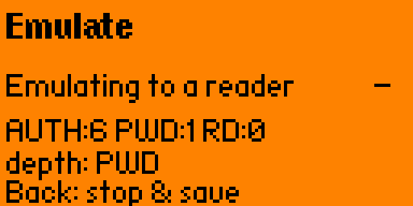
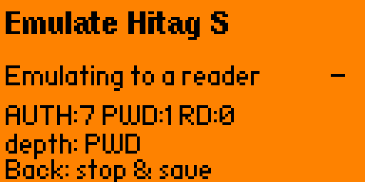

# Hitag for Flipper Zero

> Read, sniff and — uniquely — **emulate** Hitag2 and **Hitag S** (125 kHz LF)
> transponders on a Flipper Zero, including **password** and **crypto** modes.

**Status: experimental · research project.** A proof of concept, not a polished
product: it works against real readers, but success depends on marginal analog
coupling and on a firmware patch you must flash yourself.

No mainline Flipper firmware (official, Momentum, Unleashed, RogueMaster) supports
Hitag read or emulate. The only public prior art is the unmerged Hitag1 /
reader-talks-first (RTF) pull request
[flipperzero-firmware#2658](https://github.com/flipperdevices/flipperzero-firmware/pull/2658);
this project extends it to Hitag2 (password + crypto), a full Hitag S tag
implementation, and a faithful tag-emulation path.

> ⚠️ **Legal / ethical use only.** A security-research and interoperability tool.
> Use it exclusively on transponders and readers you own or are explicitly
> authorized to test. Cloning or emulating access credentials you do not own may be
> illegal in your jurisdiction.

## Documentation

- 🌐 **Landing page** — [`docs/index.html`](docs/index.html), served at
  `https://ilionel.github.io/flipper-hitag2/` once GitHub Pages is enabled
  (Settings → Pages → Deploy from branch → `main` / `/docs`).
- 📖 **Reference** — [`docs/REFERENCE.md`](docs/REFERENCE.md): every menu and its
  implications, the Hitag2 / Hitag S handshakes, the encoding, and the limitations.

## Features

**Hitag2** (PCF7936-class)
- **Read** a password-mode tag (UID + password + 8 pages); **Sniff** a real
  reader's transaction to recover its password; **Emulate** a tag to a reader
  (Normal / Tolerant modes, Fixed / Auto reply timing).
- **Crypto mode** emulation — full `nRaR` mutual authentication with the 48-bit
  Hitag2 stream cipher, then encrypted page reads (`Emulate → Hitag2`,
  auto-selected from the dump's crypto config).
- **Crypto nonce sniff** — passively collect the reader's `nR/aR` auth nonces to a
  file for the PC-side `hitag2crack` tools (the Flipper collects; the crack runs on
  a PC — see [REFERENCE §6](docs/REFERENCE.md)).

**Hitag S** (incl. 8268/8310)
- **Emulate** a complete Hitag S tag: `UID_REQ → SELECT → READ/WRITE`, across all
  four reader modes (Standard / Advanced ×2 / Fast-Advanced).
- **Authentication:** crypto/challenge (`--crypto` / `--nrar`), 8268/8310
  **password** (`--82xx`), and config **lock bits** (LKP / LCON / LCKn) enforced
  on read and write.
- **Read** (Flipper as reader): UID + SELECT are implemented; the full page loop
  is coupling-limited (see limitations).
- **82xx sniff** — passively capture the 4-byte 8268/8310 password the reader
  writes to virtual page 64 (CRC-checked) and apply it to the 82xx setting.

**General**
- **Detect** auto-rotates Hitag2 → Hitag1 → Hitag S until a tag answers.
- **Load / Save** `.hitag` dumps; edit the Hitag2 **password**, the Hitag S
  **crypto key** and the **82xx password** from the menu (no dump editing needed).
- **Persistent settings** — keys, emulate tuning and Debug toggles survive a reboot
  (saved to `settings.conf`); **Settings → Reset to defaults** restores the factory set.
- **Debug traces** toggle (off by default): diagnostic transaction logs are only
  written when you ask for them.
- A basic **Hitag1** read/emulate path is included (from the RTF base).

<p align="center">
  
  
  
</p>

## Requirements

- A Flipper Zero running **Momentum firmware patched with the RTF HAL**
  ([`firmware/`](firmware/)). The FAP calls `furi_hal_rfid_rtf_*` symbols that the
  stock SDK does not provide — **the `.fap` alone will not run.**

## Install

Two parts — see [`firmware/README.md`](firmware/README.md) for the details.

1. **Firmware.** Apply [`firmware/rtf-hal.patch`](firmware/rtf-hal.patch) to a
   Momentum tree (base commit `e1784e7`), then build & flash:
   ```bash
   git apply --3way firmware/rtf-hal.patch
   ./fbt flash_usb
   ```
2. **App.** Either grab the prebuilt `hitag.fap` from the
   [latest release](https://github.com/ilionel/flipper-hitag2/releases) and drop it
   into `SD Card / apps / RFID` (it still needs the patched **firmware** from step 1),
   or build it yourself against the patched SDK — in-tree (`./fbt fap_hitag`) or with
   `UFBT_HOME=/path/to/patched-sdk ufbt build`.

## Usage

Open **Apps → RFID → Hitag**. Lay the tag (or the reader) against the **bottom /
USB-C end** of the Flipper, where the 125 kHz coil is.

> **Coupling is the wall — you have to find it physically.** LF coupling is
> position-sensitive: a few millimetres decide whether it works. **If a read stalls
> or an emulation shows nothing, slowly move the tag — or the Flipper — relative to
> each other, a millimetre at a time, until it couples.** When emulating, watch the
> live `AUTH` / `PWD` / `RD` counters (or the read's signal bar) and keep
> repositioning until they climb; the app's *"Move to find coupling"* hint is telling
> you exactly this. Expect to hunt for the sweet spot, and expect it to be intermittent.

The bundled dump is a **demo placeholder** — load or read your own tag. For what
each menu does and when to use it, see the [reference](docs/REFERENCE.md).

## How it works

Hitag is **125 kHz LF** — nothing to do with the Flipper's 13.56 MHz NFC chip.
The STM32WB generates the carrier (TIM1), demodulates the reader via the analog
comparator (TIM2), and load-modulates the coil (the `pull_out` pin) to emulate a
tag. Replies are Manchester / anticollision coded and the payload is framed so
the reader strips its fixed start-of-frame and reads all 32 data bits faithfully
(the earlier "leadbit" workaround dropped the top bit — now fixed; validated on a
Proxmark3). The Hitag2 crypto mode reuses a small port of the 48-bit Hitag2 stream
cipher for mutual auth and per-frame encryption. Full details in the
[reference](docs/REFERENCE.md).

## Repository layout

The code is split by concern (see [REFERENCE §8](docs/REFERENCE.md) for the full table):

| Path | Role |
|---|---|
| `hitag_app.c` · `hitag_menu.c` | App: views / scenes / save-load / emulate+read handlers + entry point; and the nested Submenu UI |
| `hitag_worker.c` | Shared core: reader-command decoder, DMA plumbing, CRC, and the whole emulate tag (Hitag1 / Hitag2 password+crypto / Hitag S) |
| `hitag1.c` · `hitag2.c` · `hitags.c` | Per-protocol reader read-threads + reader-frame validators |
| `hitag_app_i.h`, `hitag_worker_i.h` | Internal headers: shared structs, on-air types, constants, cross-module decls |
| `hitag_frames.{c,h}` | Pure reader-frame classifier (Hitag2 + Hitag S) + CRC-8, PC-testable |
| `hitag2_cipher.{c,h}` | Minimal Hitag2 48-bit stream cipher (crypto-mode auth), PC-testable |
| `buffer_stream.{c,h}`, `varint_pair.{c,h}` | Utilities vendored from the upstream `lfrfid` app |
| `tools/decode_scope.py` | Off-device decode of the emulate-reply scope dumps |
| `firmware/` | The RTF HAL firmware patch + apply instructions |
| `docs/` | Landing page + reference |
| `test/` | Off-device unit tests (frame classifier, CRC-8, cipher keystream) |

## Development

The frame classifier, CRC-8 and cipher are pure modules with off-device unit
tests (cross-checked against the Proxmark3 reference):

```bash
make -C test
```

## Credits

- Hitag1 + RTF base: [flipperzero-firmware#2658](https://github.com/flipperdevices/flipperzero-firmware/pull/2658).
- Built and tested on [Momentum firmware](https://github.com/Next-Flip/Momentum-Firmware).
- Protocol ground-truth and validation with a [Proxmark3](https://github.com/RfidResearchGroup/proxmark3)
  (Iceman firmware); the Hitag2 cipher is derived from its public-domain implementation.

## License

GPLv3 — derivative of the GPLv3 flipperzero-firmware RTF work. See [LICENSE](LICENSE).
