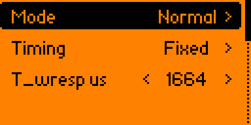

# Reference — menus, protocol & encoding

Technical reference for the Hitag Flipper app: what each menu does and its
implications, the Hitag2 / Hitag S handshakes, and how the bits are encoded on the
125 kHz link.

> Experimental research tool — see the [limitations](index.html#limits). Use only on
> tags and readers you own.

---

## 1. Menu reference

<p align="center">
  
  
</p>

The menu is organised NFC-style: a few top-level groups, and after you **read** a tag or
open a **saved** dump you land on a per-card action menu. **Back** walks one level up (and
exits at the top):

```
Read      → Detect (auto) · Hitag1 · Hitag2 · Hitag S   ─┐
Saved     → (browse the .hitag dumps directly)           ├─→ Card menu
Sniff     → Hitag2 password ─────────────────────────────┘   Info · Emulate · Save
          · Hitag2 crypto · Hitag S 82xx                      [· Rename · Delete]
Emulate   → Hitag1 · Hitag2 · Hitag S
Settings  → Emulation tuning · Hitag2 password · Hitag S key · Hitag S 82xx pwd
          · Reset to defaults
Debug     → Traces (on/off) · Lean logs (on/off)
```

The protocols are listed in **NXP release order** (Hitag1 → Hitag2 → Hitag S) under both
**Read** and **Emulate**. **Read**, the **Hitag2 password** sniff and **Saved** all converge
on the **card menu**, which acts on the tag you just captured or loaded — the same model as
the NFC app. The two **collector** sniffs (Hitag2 crypto / Hitag S 82xx) instead show a result
screen: they gather a secret the reader puts on the wire (see the sniff rows below).

| Item | What it does | Implications / when to use |
|---|---|---|
| **Read → Detect (auto)** | Rotates Hitag2 → Hitag1 → Hitag S polling until a tag answers, then locks the type. | Use when you don't know the tag type. Read-only, safe. Lands on the card menu. |
| **Read → Hitag1** | Basic Hitag1 anticollision read. | From the RTF base. **Untested** — no Hitag1 tag was available. |
| **Read → Hitag2** | Password-mode read: authenticates with the current password and reads the UID + 8 pages. | Needs the **correct password** (default `MIKR`). Coupling must carry the 32-bit auth. |
| **Read → Hitag S** | Sends `UID_REQ` then `SELECT`, reading the UID and config. | Flipper-as-reader; the full page loop is **coupling-limited** (see §6). |
| **Saved** | Opens the `.hitag` dump browser directly (NFC-style); the picked dump opens on the card menu. | Plain file I/O, no risk. The card family is recovered from the filename prefix. |
| **Sniff → Hitag2 password** | Passively logs a **real reader ↔ tag** transaction, recovering the reader's 32-bit password. | Nothing is transmitted; the recovered password fills the Hitag2 password and opens the card menu. |
| **Sniff → Hitag2 crypto** | Passively collects the reader's **`nR/aR` auth nonces** (the 64-bit crypto-auth frames) and writes them to `nonces_<uid>_<ts>.txt`. | The Flipper only **collects**; on-device key recovery is not feasible — crack the file on a PC with `hitag2crack` (see §6). Needs the tag's UID (read it first). |
| **Sniff → Hitag S 82xx** | Passively captures the 4-byte **8268/8310 password** the reader writes to virtual page 64. | The captured password is applied to **Settings → Hitag S 82xx pwd**. CRC-checked, so only a clean capture is kept. |
| **Card → Info** | The scrollable UID / password / page view of the current card. `OK` emulates it. | Reached after any Read / Sniff, or from a Saved dump. |
| **Card → Emulate** | Emulates the current card **in its own family** (Hitag1 / Hitag2 / Hitag S). | Hitag2 auto-picks password vs crypto from the dump's config page (see below). |
| **Card → Save** | Names and writes the current card as a `.hitag` dump; the name carries the family prefix. | A sniff saves as `hitag2_pw_<pwd>`; a read as `hitag1_/hitag2_/hitags_<UID>`. |
| **Card → Rename / Delete** | Shown only for a **Saved** dump: rename or remove the file on disk. | Acts on the loaded file under `apps_data/hitag`. |
| **Emulate → Hitag1 / Hitag2 / Hitag S** | Emulate **without reading first**, picking the family explicitly (mirrors Read). | Uses the current in-memory dump. Hitag2 auto-selects password vs **crypto** from its config page. |
| **Settings → Emulation tuning** | Mode / Timing / `T_wresp` / Lean logs (see below). | Tunes the Hitag2 emulate reply. |
| **Settings → Hitag2 password** | Edit the 4-byte Hitag2 password. | Default `MIKR` (`4D 49 4B 52`) = the public NXP factory-default. |
| **Settings → Hitag S key** | Edit the 6-byte Hitag S / Hitag2-crypto key. | Default `ONMIKR` (`4F 4E 4D 49 4B 52`), the Proxmark3 default `-k`. |
| **Settings → Hitag S 82xx pwd** | Edit the 4-byte 8268/8310 password. | Default `BB DD 33 99`, the Proxmark3 default. |
| **Settings → Reset to defaults** | Restore every setting (keys, passwords, emulate tuning, Debug toggles) to its factory value, saved immediately. | Does not touch loaded/read dumps — only the settings. |
| **Debug → Traces** | Toggle diagnostic file recording (off by default). | On = the transaction/sweep/sniff logs of §7 are written; off = nothing is written. |
| **Debug → Lean logs** | Skip the per-command diagnostic write during emulation. | Slightly lowers reply jitter for the tightest emulation timing. |

**Settings → Emulation tuning** items:

| Item | What it does |
|---|---|
| **Mode** — Normal / Tolerant | Normal answers the config page only when the reader's password matches your RWD; Tolerant answers on *any* 32-bit frame (use when `PWD` climbs but `RD` never does under marginal coupling). |
| **Timing** — Fixed / Auto | Fixed uses `T_wresp` below; Auto sweeps {1664, 1648, 1680} µs and locks on the first value that completes (use on a strict/unknown reader). |
| **T_wresp** — 1536–2048 µs | Reply delay after a reader command. Must land in the Hitag2 window **204–212 Tc = 1632–1696 µs** (default **1664**) — the single most sensitive knob. |

(The **Lean logs** and **Debug traces** logging toggles live in the **Debug** menu.)

> **Settings are persistent.** All of the above (the keys/passwords, the emulate Mode /
> Timing / `T_wresp`, and the Debug toggles) are saved to `apps_data/hitag/settings.conf`
> on exit and restored at startup, so they survive a reboot. **Reset to defaults** puts
> them all back and saves immediately.

> **Reply preamble (4) and leadbit are fixed** and not exposed: the norm-correct
> framing is preamble = the reader's start-of-frame length with **no leadbit** (see
> §5), so any other value would only distort a faithful emulation.

> **On Hitag1:** `Read Hitag1` / `Emulate` (Hitag1) come from the RTF base. `Read
> Hitag1` is **untested** (no Hitag1 tag was available). A Hitag1 sniff is not
> provided.

---

## 2. Hitag2 handshakes

Hitag2 is **reader-talks-first**.

**Password mode** (`Emulate → Hitag2`, config page = `0x06`):

```
reader → tag : START_AUTH        (5 bits, 0b11000)
tag    → reader : UID             (page 0, 32 bits)
reader → tag : PASSWORD           (32 bits; the RWD key, e.g. MIKR)
tag    → reader : CONFIG          (page 3, 32 bits)   ← only if the password is accepted
reader → tag : READ <page>        (10–12 bits, head 0b11)
tag    → reader : PAGE            (32 bits)
```

**Crypto mode** (`Emulate → Hitag2`, config page = `0x0E`, auto-selected):

```
reader → tag : START_AUTH        → tag replies UID (plain)
reader → tag : nR + aR           (64 bits)           ← nR nonce + authenticator
tag              : cipher_reset(key, UID, nR); verify aR
tag    → reader : encrypted reply, cipher now engaged
reader ↔ tag : all further READ commands & page replies are stream-encrypted
```

The live counters map onto these: `AUTH` = START_AUTH, `PWD` = password / accepted
`nRaR`, `RD` = read command. Watching where they stall tells you which step fails.

---

## 3. Hitag S protocol (emulation)

A Hitag S reader picks a **protocol mode** via the UID-request opcode; the tag must
answer in the matching coding and start-of-frame (SOF):

| Reader mode | UID_REQ opcode | UID reply | SELECT / READ reply |
|---|---|---|---|
| Standard | `00110` | AC, 1-bit SOF | MC, 1-bit SOF, **no CRC** |
| Advanced (×2) | `11000` / `11001` | AC, 3-bit SOF | MC, 6-bit SOF, **+ CRC-8** |
| Fast Advanced | `11010` | AC4K, 3-bit SOF | MC8K, 6-bit SOF, + CRC-8 (double rate) |

Flow: `UID_REQ → UID`; `SELECT(00000 + UID + CRC8) → config`; `READ(1100/1101 +
addr + CRC8) → page`; `WRITE(1000 + addr + CRC8) → ACK, then a 32-bit data frame →
ACK`. **Authentication:** `config.auth=1` triggers a 64-bit challenge (`--crypto` /
`--nrar`); 8268/8310 writes the password to virtual page 64 (`--82xx`). **Locks:**
`LKP` / `LCON` / `LCKn` in the config page are enforced — a locked page is refused on
write, and key pages 2/3 return nothing in auth mode. CRC-8 is `poly 0x1D / init
0xFF` (the Hitag1/Hitag S CRC).

---

## 4. Encoding

- Carrier: **125 kHz**, one carrier period **Tc = 8 µs**.
- Tag → reader bit period: **32 Tc = 256 µs** (~3.9 kbit/s), Manchester (MC) or, for
  the Hitag S UID reply, anticollision (AC) coded. Fast-Advanced doubles the rate.
- Reader → tag commands are classified purely by **length + leading pattern** (see
  [`hitag_frames.h`](../hitag_frames.h)); the Hitag2 tolerances (5–7 / 10–12 /
  31–34 bits) absorb the odd spurious edge under marginal coupling.

### Reply timing (T_wresp)
The tag replies a fixed delay after the reader command: **204–212 Tc (1632–1696 µs)**.
The emulator waits `T_wresp` (default 1664 µs) from the command's last edge, timed in
hardware so it lands in the window even on a strict reader.

---

## 5. The reply-framing fix

The Proxmark3 reader strips a **fixed-length start-of-frame** (a run of `1`s,
`tag_sof = 4` for Hitag2) from the tag reply, then reads the rest as data. An earlier
version prepended a `0` "leadbit" and pre-shifted the payload `<< 1` — which **dropped
bit 31** of every page (a page `0xAAAAAAAA` read back as `0x2AAAAAAA`).

**Fix:** send `preamble = tag_sof` (4) ones and the **raw 32 data bits** — no leadbit,
no pre-shift. The reader then strips its SOF and reads all 32 bits **faithfully**.
Bench-proven on a Proxmark3 (pages `0xAAAAAAAA` now read back exactly), and it is what
unblocked the **crypto** read: encrypted replies are random 32-bit values, so any
bit-31 loss would corrupt them. This is the norm-correct behaviour of a real tag.

---

## 6. Limitations

- **Coupling is the wall.** LF load-modulation is position-sensitive; reads and
  emulation are intermittent unless the coil is well placed. **When it isn't working,
  slowly move the tag — or the Flipper — relative to each other, a millimetre at a time,
  until the counters climb (emulate) or the signal bar fills (read).** There is no
  setting that substitutes for finding the physical sweet spot. The Fast-Advanced
  Hitag S mode (double rate) is the most coupling-sensitive.
- **Hitag S read** (Flipper-as-reader) implements UID + SELECT; the full page loop is
  coupling-limited and not fully validated with the bench rig.
- **Hitag2 crypto** authenticates and reads faithfully, but like everything here its
  completion rate depends on coupling.
- **Sniff collectors are hardware-gated.** The Hitag2-password sniff is bench-proven. The
  **Hitag2-crypto** and **Hitag S 82xx** sniffs only capture a secret the reader actually
  puts on the wire, so they need a *real* reader ↔ tag crypto / 82xx transaction to observe;
  the frame **decode** is unit-tested (frame classifier + CRC-checked data frame), but the
  end-to-end capture is validated only as far as the available tags allow — treat them as
  experimental, like `Read Hitag S`.

### Cracking the crypto nonces (on a PC)

The Flipper is a **collector**, not a cracker — exactly like the Proxmark3, whose ARM gathers
nonces while the key recovery runs on the host. Hitag2's 48-bit cipher is broken only by
tools that need a **GPU**, a **~1 TB table**, or many minutes of multi-core CPU — none of
which fit a 64 MHz / 256 KB microcontroller. So `Sniff → Hitag2 crypto` writes the `nR/aR`
pairs to `nonces_<uid>_<ts>.txt`; recover the key on a PC, e.g.:

```
ht2crack5 <UID> <nR0> <aR0> <nR1> <aR1>      # 2 nonces, GPU/CPU
# or feed the pairs to ht2crack2 / ht2crack4 per their docs
```

The UID is not secret — read it first (`Read → Hitag2`) so the export header carries it.
A **password-mode** tag (config `0x06`, the common access-badge case) needs none of this: its
`Sniff → Hitag2 password` recovers the key in the clear.

---

## 7. Diagnostic logs (opt-in)

With **Debug traces** on (Emulation settings), sessions write timestamped text files
to `apps_data/hitag/`; with it **off (default) nothing is written**:

| File | Contents |
|---|---|
| `emulog_<ts>.txt` | Every reader command received while emulating (the handshake trace). |
| `snifflog_<pwd>_<ts>.txt` | Full reader transaction captured while sniffing. |
| `autotune_<ts>.txt` | Per-`T_wresp` AUTH/PWD/READ tallies and the best combo. |

Enable **Lean logs** to skip the per-command write when you need the tightest reply
timing.

---

## 8. Project layout

The code is split by concern (the FAP has no single monolith):

| File | Role |
|---|---|
| `hitag_app.c` · `hitag_menu.c` | App: views / scenes / file I/O + entry point; and the nested Submenu UI (build + dispatch + Back). |
| `hitag_app_i.h` | Internal header: app struct, view/menu enums, layout constants, handler decls. |
| `hitag_worker.c` | Shared signal core: the reader-command decoder, the DMA reply plumbing, the CRC helpers, and the whole **emulate** tag (Hitag1 / Hitag2 password+crypto / Hitag S) in one thread. |
| `hitag_worker_i.h` | Internal header: worker struct, on-air frame types, timing/framing constants, cross-module decls. |
| `hitag1.c` · `hitag2.c` · `hitags.c` | Per-protocol **reader** read-threads + reader-frame validators. |
| `hitag_frames.c/.h` | Pure reader-frame classifiers (Hitag2 + Hitag S) and the CRC-8 — unit-tested off device. |
| `hitag2_cipher.c/.h` | The 48-bit Hitag2 stream cipher (crypto auth) — unit-tested against the Proxmark3 reference. |
| `buffer_stream` · `varint_pair` | Generic capture-buffer plumbing, vendored from the firmware's `lib/lfrfid`. |

The emulate tag lives in one thread in `hitag_worker.c` on purpose: it is the timing-critical,
bench-validated path, kept intact rather than decomposed.
